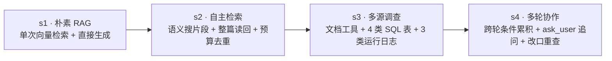

# FlowPay — 可追踪的多阶段 Agentic RAG 系统

FlowPay 是一个面向支付平台技术支持与故障排查场景的 **可追踪 Agentic RAG（检索增强生成）全栈系统**。项目以真实的支付网关业务（客户、支付、退款、订阅、账单、Webhook 投递与平台事故）为背景，通过 **四个递进式阶段（`s1` → `s2` → `s3` → `s4`）** 完整呈现从朴素 RAG 到多源联合调查、再到多轮状态管理与主动澄清的演进过程。

系统配套 **基于事件溯源（Event Sourcing）的可回放运行时**、**React 19 对话与轨迹检视控制台**，以及包含 **100 篇业务知识文档、确定性业务模拟器与 300 道冻结 Benchmark** 的完整评测体系。

---

## 目录

- [四阶段演进架构 (`s1` — `s4`)](#四阶段演进架构-s1--s4)
- [Benchmark 评测结果](#benchmark-评测结果)
- [核心工程特性](#核心工程特性)
- [技术栈](#技术栈)
- [目录结构](#目录结构)
- [快速开始](#快速开始)
  - [1. 配置环境变量](#1-配置环境变量)
  - [2. 方式一：Docker 全栈一键启动（推荐）](#2-方式一docker-全栈一键启动推荐)
  - [3. 方式二：宿主机本地开发与调试](#3-方式二宿主机本地开发与调试)
- [常用命令速查](#常用命令速查)
- [HTTP / SSE 接口概览](#http--sse-接口概览)
- [架构与编码约定](#架构与编码约定)

---

## 四阶段演进架构 (`s1` — `s4`)

每个阶段均位于 `backend/src/flowpay/workflows/sN.py` 独立文件中，包含该阶段专属的编排逻辑、手写 Agent Loop、提示词与状态结构，各阶段互不继承，共享底层 `core` 能力接口：



| 阶段 | 工作流标识 | 核心能力与机制 | 可用工具 | 每轮预算（模型 / 工具） |
| :--- | :--- | :--- | :--- | :--- |
| **`s1` · 朴素 RAG** | `flowpay-document-rag` | 拼接最近两轮对话背景执行单次 Top-10 语义检索，直接生成带来源引用的 Markdown 回答；不重试、不补搜，作为对照基线。 | 内置单次向量检索 | 1 次 / 0 次 |
| **`s2` · 自主检索** | `flowpay-agentic-rag` | 手写 Agent Loop，由模型自主决定搜什么、何时整篇读回完整规则、何时结束回答；两个工具共用预算与大小写无关去重。 | `search_documents`<br/>`read_document` | 5 次 / 3 次 |
| **`s3` · 多源调查** | `flowpay-multi-source-rag` | 引入受只读策略与 Schema 枚举约束的业务数据库与运行日志工具，根据上一步查到的真实 ID（如 `request_id` → `payment_id` → `event_id` → `delivery_id`）串联多跳排查。 | 文档工具 × 2<br/>SQL 关系查询 × 4<br/>JSONL 日志查询 × 3 | 10 次 / 8 次 |
| **`s4` · 多轮协作** | `flowpay-multi-turn-rag` | 跨轮维护 `Case`（已知条件）与 `Revision`（补齐 / 改口 / 失效编号）；条件不足时调用 `ask_user` 显式暂停等待用户补充（机制级拦截重复索要）；用户更换账户或环境时自动作废旧作用域编号并重查。 | `ask_user` + `s3` 全部 9 个工具 | 10 次 / 8 次 |

### `s3` / `s4` 业务调查工具清单

所有业务工具均由 `backend/policies/sources.toml` 声明表列白名单、必填租户隔离作用域（`account_id` + `environment`）与封闭枚举值：

- **SQL 关系查询（SQLite `flowpay.sqlite`）**
  - `query_payments`：按支付编号、状态、创建请求编号或客户编号查询支付记录。
  - `query_events`：按事件编号、关联对象编号、事件类型或触发请求查询业务事件。
  - `query_deliveries`：查询 Webhook 投递状态、尝试次数、下次重试时间与终止原因。
  - `query_endpoints`：查询账户下 Webhook 端点的启用状态、停用时间、API 版本与重试策略。
- **运行日志查询（JSONL `runtime/*.jsonl`）**
  - `get_api_request`：按请求编号查询 API 调用的 HTTP 状态码、错误码及创建的对象。
  - `list_delivery_attempts`：按投递编号查询每次 Webhook 投递尝试的响应码、耗时与重试安排。
  - `list_incidents`：按服务（`api` / `payments` / `webhooks`）、区域（`NA` / `EU` / `APAC`）与时间窗口查询平台故障。

---

## Benchmark 评测结果

数据集内置 **300 道冻结评测题**（涵盖 `simple_retrieval`、`multi_document`、`multi_hop`、`temporal_versioned`、`tool_use_diagnostic`、`multi_source` 六大题型，其中单轮题 120 道、多轮渐进披露题 180 道）。评测从两条正交维度独立打分：

- **任务通过（Task Pass）**：回答覆盖全部必需断言（`required_assertions`），且未触发任何禁止结论（`negative_assertions`）。
- **文档证据命中（Evidence Hit）**：检索过程完整命中题目指定的标准知识文档证据。

各阶段在单轮与多轮评测集上的实测表现如下：

| 阶段 | 轮次 | 断言覆盖 | 任务通过题数 | 文档证据命中 |
| :--- | :--- | :--- | :--- | :--- |
| **`s1`** | 单轮 | 100/120（83.3%） | 95/120（79.2%） | 98/120（81.6%） |
| **`s1`** | 多轮 | 120/320（37.5%） | 23/180（12.8%） | 99/460（21.5%） |
| **`s2`** | 单轮 | 105/120（87.5%） | 103/120（85.8%） | 115/120（95.8%） |
| **`s2`** | 多轮 | 220/320（68.8%） | 87/180（48.3%） | 241/460（52.4%） |
| **`s3`** | 多轮 | 289/320（90.3%） | 163/180（90.5%） | 422/460（91.7%） |
| **`s4`** | 多轮 | 285/320（89.1%） | 158/180（87.8%） | 443/460（96.3%） |

---

## 核心工程特性

- **严格的分层解耦设计**：
  - `workflows/` 只负责阶段编排、手写 Agent Loop、提示词与阶段专有状态，不直接创建 SDK 或数据库客户端。
  - `core/` 提供与具体业务阶段无关的底座能力（模型流式协议解析、向量知识库读取、策略驱动的数据源查询、事件溯源存储、异步会话管理与 FastAPI 服务）。
- **全链路事件溯源与可回放轨迹（Traceable Runtime）**：
  - 每次会话的模型输入输出、Token 用量、工具调用参数与返回摘要、检索命中的文档片段及阶段检查点（Checkpoint）均以只追加事件流持久化到 SQLite。
  - 前端控制台实时投影事件流，支持按运行轮次过滤、宽屏检视完整 Prompt / Tool Call 载荷，并支持一键导出会话 `.jsonl` 轨迹文件。
- **可靠的异步执行与断线重连协议**：
  - 消息提交接口立即返回 `202 Accepted`，后台独立管理运行生命周期；网页刷新或 SSE 断开不会中断模型执行。
  - SSE 订阅支持 `after` 游标与 `Last-Event-ID` 自动重连补齐，支持运行中途显式取消（Cancel）与中断后继续执行（Continue）。
- **向量空间一致性与只读安全护栏**：
  - 知识库基于 PostgreSQL `pgvector` 构建，包含只追加触发器与读写角色分离（`flowpay_admin` / `flowpay_knowledge_builder` / `flowpay_knowledge_reader`）；启动时强制校验 Ollama 嵌入模型 digest revision，防止模型版本漂移导致检索退化。
  - 业务数据查询强制校验租户 `scope`（`account_id` + `environment`）与字段白名单，杜绝跨租户数据泄露与 SQL 注入。

---

## 技术栈

| 领域 | 技术选型 |
| :--- | :--- |
| **后端运行时** | Python 3.12+、FastAPI、Uvicorn、Pydantic v2、SQLAlchemy 2、Alembic、Psycopg 3 |
| **大模型与嵌入** | OpenAI 兼容 Chat 接口（默认配置 DeepSeek，可切换任意兼容服务）、Ollama 本地嵌入（`qwen3-embedding:0.6b`，1024 维） |
| **数据与存储** | PostgreSQL 17 + `pgvector`（知识库 100 篇文档 / 712 个向量片段）、SQLite（会话事件存储 & 模拟业务事实表）、JSONL（模拟运行日志） |
| **前端控制台** | React 19、TypeScript 5.9、Vite 7、Tailwind CSS v4、Radix UI、Lucide Icons |
| **质量与工程工具** | `uv`、Ruff、basedpyright、Pytest、Vitest、Prettier、Docker Compose |

---

## 目录结构

```text
FlowPay/
├── backend/                        # 后端服务与核心实现
│   ├── configs/                    # 运行配置 (local.toml) 与知识集合配置 (knowledge.toml)
│   ├── migrations/                 # Alembic 迁移脚本与知识库 SQL 结构定义
│   ├── policies/                   # 业务数据源访问策略与表列白名单 (sources.toml)
│   ├── src/flowpay/
│   │   ├── core/                   # 通用底座：agent、chat、config、data_sources、event_log、execution、http、knowledge、llm、tools
│   │   ├── workflows/              # 四阶段编排实现：s1.py、s2.py、s3.py、s4.py
│   │   ├── bootstrap.py            # 运行时配置与工作流对象装配
│   │   ├── router.py               # 阶段注册与选择入口
│   │   └── cli.py                  # 命令行启动入口
│   └── tests/                      # 后端单元测试与边界契约测试 (core / workflows / scripts)
├── frontend/                       # React 19 + Vite 前端交互与轨迹检视控制台
│   └── src/
│       ├── components/             # 对话面板 (chat-panel)、运行轨迹 (run-trace)、会话导航与详情弹窗
│       ├── hooks/                  # 会话目录、SSE 事件订阅、运行操作与轨迹投影 Hooks
│       └── lib/                    # API 客户端与展示格式化工具
├── flowpay-dataset/                # 数据工程：100 篇知识文档、300 道冻结 Benchmark 与确定性场景模拟器
│   ├── benchmark/                  # 题目蓝图 (design)、编译命令 (compiled)、证据解析 (resolved) 与可读文档 (readable)
│   ├── data/                       # 知识语料 (knowledge)、切块索引 (index)、发布清单 (releases) 与生成快照 (generated)
│   ├── docs/                       # 业务规则总表、模拟器设计与 300 题 Benchmark 规范文档
│   ├── postgres/                   # 预构建知识库向量备份 (flowpay_knowledge.dump)
│   └── src/flowpay_simulator/      # 零第三方依赖的确定性业务数据与日志模拟器
├── scripts/                        # 自动化运维、数据库迁移、知识入库、质量门禁与 Benchmark 评测脚本
├── infra/                          # Docker 镜像构建文件与 PostgreSQL 初始化脚本
├── compose.yaml                    # 全栈容器编排 (postgres + dataset-init + ollama + backend + frontend)
├── Makefile                        # Linux / macOS 常用开发与运维命令入口
├── manage.ps1 / manage.bat         # Windows 平台 1:1 对标 Makefile 的项目管理脚本
└── AGENTS.md                       # 项目架构边界与编码规范约定
```

---

## 快速开始

### 1. 配置环境变量

在仓库根目录将 `.env.example` 复制为 `.env`，并填写聊天模型密钥与数据集路径：

```ini
# 必填：聊天模型 API Key
FLOWPAY_MODEL_API_KEY='your-api-key'

# 可选：自定义任何 OpenAI 兼容的模型服务（留空则使用 backend/configs/local.toml 中的默认值）
# FLOWPAY_MODEL_BASE_URL='https://api.openai.com/v1'
# FLOWPAY_MODEL_NAME='gpt-4.1-mini'
FLOWPAY_MODEL_BASE_URL=''
FLOWPAY_MODEL_NAME=''

# 必填：指向数据集目录（或 .tar.gz / .zip 数据包路径）
FLOWPAY_DATASET_ROOT='./flowpay-dataset'

# 本地嵌入服务默认密钥
OLLAMA_API_KEY=ollama
```

---

### 2. 方式一：Docker 全栈一键启动（推荐）

只需安装 Docker 与 Docker Compose，无需在宿主机手动配置 Python 或 Node.js 环境。一键启动命令会自动完成：
1. 校验 `.env` 与数据集目录完整性；
2. 首次运行时通过模拟器生成约 152 MB 的确定性业务快照（`flowpay.sqlite` 与 `runtime/*.jsonl`）；
3. 启动 PostgreSQL（`pgvector`）并导入 100 篇知识文档与 712 个向量；
4. 启动 Ollama 容器并拉取、校验 `qwen3-embedding:0.6b` 嵌入模型；
5. 启动后端与前端容器。

**Linux / macOS：**

```bash
# 默认启动 s1 阶段
make up

# 指定阶段启动（可选 s1、s2、s3、s4）
STAGE=s4 make up

# 查看容器日志 / 停止容器
make logs
make down
```

**Windows (PowerShell / CMD)：**

```powershell
# 默认启动 s1 阶段
.\manage.ps1 up

# 指定阶段启动（可选 s1、s2、s3、s4）
.\manage.ps1 up --stage s4

# 查看容器日志 / 停止容器
.\manage.ps1 logs
.\manage.ps1 down
```

启动完成后访问：
- **前端控制台**：[http://127.0.0.1:5173/](http://127.0.0.1:5173/)
- **后端 API**：[http://127.0.0.1:8000/](http://127.0.0.1:8000/)

---

### 3. 方式二：宿主机本地开发与调试

如果需要修改 `backend/` 或 `frontend/` 代码并进行断点调试，可在宿主机直接运行服务（需安装 Python 3.12+、`uv`、Node.js 22.12+、Docker 以及本地 Ollama）：

**Linux / macOS：**

```bash
# 1. 环境自检与一键初始化（安装依赖、启动 Postgres、迁移建表、导入知识集合）
make doctor
make setup

# 2. 启动后端服务（通过 STAGE 指定 s1 / s2 / s3 / s4）
make run STAGE=s4

# 3. 另起终端启动前端开发服务器
make frontend
```

**Windows (PowerShell)：**

```powershell
# 1. 环境自检与一键初始化
.\manage.ps1 doctor
.\manage.ps1 setup

# 2. 启动后端服务（通过 -Stage 指定 s1 / s2 / s3 / s4）
.\manage.ps1 run -Stage s4

# 3. 另起终端启动前端开发服务器
.\manage.ps1 frontend
```

---

## 常用命令速查

项目在 Linux/macOS 下使用 `Makefile`，在 Windows 下提供 1:1 对标的 `manage.ps1`（及 `manage.bat`）：

| 功能说明 | Linux / macOS (`make`) | Windows (`.\manage.ps1`) |
| :--- | :--- | :--- |
| **列出所有可用命令** | `make help` | `.\manage.ps1 help` |
| **一键拉起全栈容器** | `make up [STAGE=s4] [BUILD=1]` | `.\manage.ps1 up [--stage s4] [--build]` |
| **停止全栈容器（保留数据卷）** | `make down` | `.\manage.ps1 down` |
| **跟踪前后端容器日志** | `make logs` | `.\manage.ps1 logs` |
| **只读检查宿主机基础环境** | `make doctor` | `.\manage.ps1 doctor` |
| **准备本地开发依赖、数据库与知识库** | `make setup` | `.\manage.ps1 setup` |
| **仅启动 PostgreSQL 容器** | `make db-up` | `.\manage.ps1 db-up` |
| **执行知识库结构迁移与角色授权** | `make db-setup` | `.\manage.ps1 db-setup` |
| **宿主机启动后端服务** | `make run STAGE=s4` | `.\manage.ps1 run -Stage s4` |
| **宿主机启动前端开发服务** | `make frontend` | `.\manage.ps1 frontend` |
| **运行后端单元测试** | `make test` | `.\manage.ps1 test` |
| **运行全量代码质量门禁**（Ruff / Pyright / Pytest / 前端构建） | `make quality` | `.\manage.ps1 quality` |
| **运行 300 题分层 Benchmark**（`PER_TYPE=0` 为全量） | `make benchmark STAGES=s1,s2,s3,s4 PER_TYPE=2` | `.\manage.ps1 benchmark`（可追加 `--per-type 0`） |
| **将 300 道题目渲染为可读 Markdown** | `make blueprints` | `.\manage.ps1 blueprints` |
| **启动确定性协议演示后端**（不调外部模型） | `make demo` | `.\manage.ps1 demo` |
| **对运行中后端执行 HTTP/SSE 冒烟验收** | `make smoke` | `.\manage.ps1 smoke` |

---

## HTTP / SSE 接口概览

后端服务（默认 `http://127.0.0.1:8000`）提供与具体检索阶段解耦的 REST + SSE 接口：

| 方法 | 路径 | 状态码 | 说明 |
| :--- | :--- | :--- | :--- |
| `GET` | `/api/health` | `200` / `503` | 检查服务与底层会话存储健康状态 |
| `GET` | `/api/meta` | `200` | 获取当前协议版本、激活的阶段信息（`id` / `label` / `description`）、模型名称与示例问题 |
| `GET` | `/api/sessions` | `200` | 获取全部会话摘要列表 |
| `POST` | `/api/sessions` | `201` | 创建新会话 |
| `GET` | `/api/sessions/{session_id}` | `200` | 获取指定会话的聚合视图（状态、消息列表、最新运行信息） |
| `DELETE` | `/api/sessions/{session_id}` | `200` | 删除单个会话 |
| `POST` | `/api/sessions/batch-delete` | `200` | 批量删除会话（最多 100 个） |
| `POST` | `/api/sessions/{session_id}/messages` | `202` | 提交用户消息并异步启动本轮运行（含幂等 `request_id`） |
| `POST` | `/api/sessions/{session_id}/continue` | `202` | 从已取消或中断的回合恢复运行 |
| `POST` | `/api/sessions/{session_id}/cancel` | `200` | 取消当前正在执行的会话运行 |
| `GET` | `/api/sessions/{session_id}/events` | `200` | 按序号增量拉取会话已持久化的事件列表（`?after=0`） |
| `GET` | `/api/sessions/{session_id}/stream` | `200` | 建立 SSE 实时事件流订阅（支持 `?after=` 与 `Last-Event-ID` 断线续传） |
| `GET` | `/api/sessions/{session_id}/export` | `200` | 导出指定会话的完整事件日志为 `.jsonl` 文件 |

---

## 架构与编码约定

项目遵循严格的模块职责边界（详见 [AGENTS.md](./AGENTS.md)）：

1. **阶段独立性**：每个阶段使用 `workflows/sN.py` 独立文件，包含本阶段编排、提示词和专有状态；不继承或调用其他阶段的 `run`，只注册已实现阶段。
2. **工作流纯粹性**：`workflows` 只展示阶段编排、手写 Agent Loop、提示词与业务决策，通过类型明确的能力接口调用下层；不在 `workflows` 中创建 SDK/数据库客户端，也不实现 HTTP/SSE/SQL/文件读取、追踪落库或模型原生协议解析。
3. **单向依赖规则**：通用能力及其实现放 `core`；发布文档导入、模拟服务与验收放 `scripts`；具体对象装配放 `flowpay/bootstrap.py`，阶段注册与选择放 `flowpay/router.py`。`core` 不依赖 `workflows`、`router`、`bootstrap` 或 `scripts`。
4. **前端职责分离**：前端组件声明实际所需 props；事件解释集中在投影层（`trace.ts` / `state.ts`），SSE 订阅、运行操作与本地草稿分别由独立模块管理。
